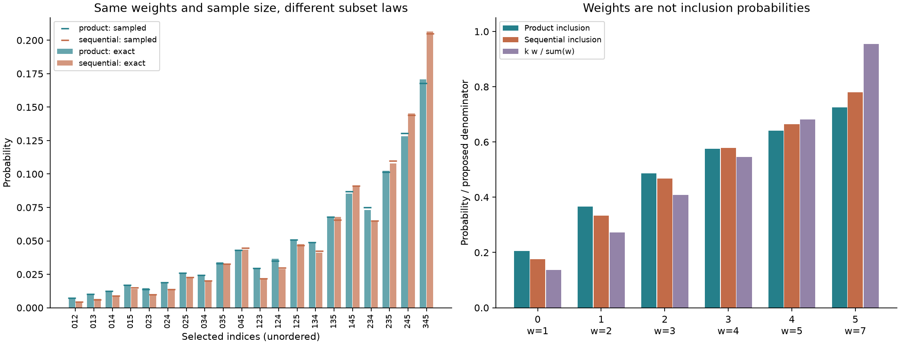
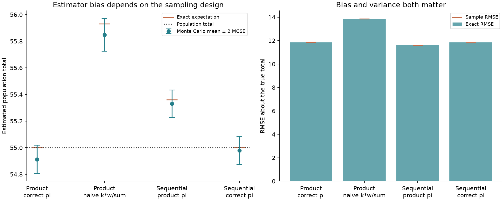

# Fixed-size sampling laws

**“Weighted sampling without replacement” does not specify a unique sampling
distribution.** This project compares two valid but different designs and
shows why their inclusion probabilities cannot be interchanged in estimation.

It implements a log-domain product-subset sampler, first- and second-order
inclusion probabilities, and design-aware Horvitz–Thompson totals. A separate
small-population oracle uses exact rational arithmetic to enumerate both the
product law and the sequential Plackett–Luce law. Seeded simulations are checked
against those oracles, not just against another implementation of the same
recurrence.

This is an independent educational implementation of established sampling
methods. It is not a new statistical method or a real-world performance claim.



## Reproduce

Python 3.11 or later:

```bash
python3 -m venv .venv
source .venv/bin/activate
python -m pip install '.[test]'
python -m pytest -W error
sampling-experiment --output results
```

The default run draws 50,000 subsets under each design. It writes two figures
and `summary.json`, including all population values, weights, seeds, subset
counts, exact probabilities as fractions, inclusion probabilities, and exact
and empirical estimator moments. No external datasets or credentials are used;
no network access is needed after installation.

Use a separate output directory to keep the checked-in results:

```bash
sampling-experiment --output /tmp/sampling-results --draws 50000
```

The stored run uses Python 3.13.0. For its runtime/test dependency snapshot,
use a fresh Python 3.13 environment:

```bash
python -m pip install -r requirements-repro.txt
python -m pip install --no-deps .
sampling-experiment --output /tmp/sampling-reproduction
```

Summary JSON repeats exactly in the same environment. Dependency versions,
floating-point implementations, and rendering may change final digits or PNG
bytes across platforms. CI runs tests and the complete example on Python 3.11
and 3.13 using the supported dependency ranges, not the Python 3.13 snapshot.

## Two laws, not two implementations of one law

Let $w_i\ge0$ be fixed weights and let exactly $k$ distinct items be selected.
At least $k$ weights must be positive.

### 1. Product-subset / conditional-Poisson design

For an unordered subset $S$ of size $k$,

$$P_{\mathrm{prod}}(S)=\frac{\prod_{i\in S}w_i}{Z_k(w)},
\qquad Z_k(w)=\sum_{|T|=k}\prod_{i\in T}w_i.$$

These weights are **odds parameters**, not marginal inclusion probabilities.
One interpretation is independent Bernoulli selections with success odds
$w_i$, conditioned on their count being $k$. Despite the name
“conditional Poisson,” the individual selections in this interpretation are
Bernoulli indicators, not unrestricted Poisson counts. Multiplying every
weight by the same positive constant leaves the conditional law unchanged.

### 2. Sequential weighted-without-replacement design

An ordered sequence $(i_1,\ldots,i_k)$ has probability

$$P_{\mathrm{seq}}(i_1,\ldots,i_k)=
\prod_{t=1}^k\frac{w_{i_t}}{\sum_jw_j-\sum_{u<t}w_{i_u}}.$$

The unordered probability is the sum over all permutations of the subset.
This is the Plackett–Luce design with order discarded. The included
`gumbel_top_k` function samples this law by taking the largest $k$ independent
Gumbel-perturbed log weights. It does **not** sample the product-subset law.

Both designs agree for $k=1$, equal positive weights, and a sample that includes
every positive-weight item. They need not agree otherwise. For weights
`[1, 2, 4]` and `k=2`, exact enumeration gives:

| Selected indices | Product-subset probability | Sequential probability |
| --- | ---: | ---: |
| `{0,1}` | 1/7 | 11/105 |
| `{0,2}` | 2/7 | 2/7 |
| `{1,2}` | 4/7 | 64/105 |

Neither design is declared intrinsically better. The point is to make the
sampling contract explicit and use probabilities from that contract.

## Dynamic programming and numerical safeguards

Let $E_{i,r}$ be the elementary symmetric sum of degree $r$ over the first $i$
weights. The recurrence is

$$E_{i,r}=E_{i-1,r}+w_{i-1}E_{i-1,r-1},\qquad E_{i,0}=1.$$

`ProductSubset` evaluates this in log space with `logaddexp`, after subtracting
the largest finite log weight. Impossible states have log mass $-\infty$.
Prefix and suffix tables give the marginal probabilities

$$\pi_i=P(i\in S)=\frac{w_i Z_{k-1}(w_{-i})}{Z_k(w)}.$$

Sampling traverses items backwards. If $r$ selections remain among indices
`0,...,i`, it includes item $i$ with probability

$$\frac{w_iE_{i,r-1}}{E_{i+1,r}}.$$

Zero-weight items are skipped, and any remaining positive-weight items are
forced in when they are all required. Every returned Boolean mask contains
exactly $k$ selected items. Sampling uses explicit NumPy generators, not global
random state.

For pairwise probabilities, fixing item $i$ as selected leaves the same
product law over the other items with sample size $k-1$:

$$\pi_{ij}=\pi_i P(j\in S\mid i\in S),\qquad \pi_{ii}=\pi_i.$$

The implementation recomputes conditional tables rather than subtracting
nearly equal weights. Consequently, indicator covariance is
$\pi_{ij}-\pi_i\pi_j$. Tests check it against exact enumeration, including
symmetry, positive semidefiniteness to numerical tolerance, and zero row sums
from the fixed sample size. Finite-difference tests also check the identities
$\nabla_{\log w}\log Z=\pi$ and
$\nabla^2_{\log w}\log Z=\operatorname{Cov}(I)$.

Complexity for $n$ items:

| Operation | Time | Storage |
| --- | --- | --- |
| Prefix/suffix construction | O(nk) | O(nk) |
| All first-order probabilities | O(nk) | O(n) extra |
| All pairwise probabilities | O(n²k) | O(n² + nk) peak |
| Batch of R samples after construction | O(Rn) | O(Rn) output plus O(R) workspace |

The probability law is exact mathematically; **the sampler and DP use
float64, not exact real arithmetic**. Very small probabilities can underflow
to zero. `log_inclusion_probabilities` retains their logarithms, and total
estimation rejects a nonzero target with a zero or numerically underflowed
inclusion probability. Infinite weights and externally specified target
inclusion probabilities are not supported.

## Design-aware estimation

For fixed finite-population values $y_i$, the Horvitz–Thompson estimator is

$$\widehat T=\sum_{i\in S}\frac{y_i}{\pi_i}.$$

Zero-valued items with zero inclusion probability are omitted from these sums.
If every nonzero target has positive inclusion probability under the actual
sampling design, its expectation equals $T=\sum_i y_i$. Its variance is

$$\operatorname{Var}(\widehat T)=
\sum_{i,j}(\pi_{ij}-\pi_i\pi_j)\frac{y_i y_j}{\pi_i\pi_j}.$$

The API validates shape, support, and sample size, but cannot infer which
random mechanism produced an externally supplied mask. The caller must use
the matching design. In particular, $kw_i/\sum_jw_j$ generally is not the
inclusion probability for either design. It can even exceed one; the experiment
below deliberately uses a case where every such denominator is below one, so
that a simple range check would not detect the mistake.

## Controlled finite-population experiment

The population has six items, weights `[1, 2, 3, 4, 5, 7]`, values
`[4, 9, 2, 14, 5, 21]`, sample size 3, and total **55**. These are explicitly
chosen synthetic values, not sampled personal or real-world records.

All 20 subsets and all 120 ordered selections can be enumerated. The
independent oracle uses Python `Fraction` arithmetic: products and permutation
sums are rational, with no DP or Gumbel calculation involved. The two subset
laws have total-variation distance approximately **0.065647**.

Product samples use seed `20261020`; sequential samples use `20261021`.
Within each design, both estimators reuse the same 50,000 subsets, so their
simulation errors are correlated. Different designs use separate random streams.

### Stored results

| Sampling design / denominator | Exact expectation | Simulated mean | Exact bias | Exact RMSE |
| --- | ---: | ---: | ---: | ---: |
| Product / product inclusion | 55.000000 | 54.912571 | 0 | 11.8472 |
| Product / naive `k*w/sum(w)` | 55.930081 | 55.847440 | +0.930081 | 13.8131 |
| Sequential / wrong product inclusion | 55.360762 | 55.329993 | +0.360762 | 11.6057 |
| Sequential / sequential inclusion | 55.000000 | 54.979598 | 0 | 11.8534 |

The exact means of the two correct estimators are the rational number `55`,
not a Monte Carlo approximation. Incorrect correction factors introduce bias
in this example. Notice also that the mismatched sequential estimator has a
slightly **lower RMSE** here: unbiasedness is not the same as minimum mean
squared error. This experiment does not claim one design or correction has
universally smaller variance or RMSE.



Error bars on the simulated means are twice the Monte Carlo standard error
computed from exact design variance, $2\sqrt{\operatorname{Var}(\widehat T)/R}$.
They describe simulation uncertainty of a mean over R draws, not uncertainty
of a single population-total estimate, and are not exact simultaneous confidence
intervals. The mean panel has a zoomed vertical scale to expose the small biases.

The executable checks every empirical subset frequency against its rational
probability with tolerance `6*sqrt(p*(1-p)/R) + 1/R`, and checks each simulated
mean within six theoretical MC standard errors. These are diagnostic tolerances,
not a joint probability guarantee. Exact fractions and individual counts are
retained in the JSON report.

## API example

```python
import numpy as np
from sampling_laws import ProductSubset

design = ProductSubset([1, 2, 4], k=2)
print(design.inclusion_probabilities())  # approximately [3/7, 5/7, 6/7]
masks = design.sample(1000, np.random.default_rng(42))
assert np.all(masks.sum(axis=1) == 2)
totals = design.ht_totals([3, 5, 8], masks)
# The exact design expectation of each total is 16;
# a finite simulated average need not equal 16 exactly.
```

`gumbel_top_k(weights, k, draws, rng)` returns masks with the same shape but a
different law. The rational `reference` module is intentionally restricted to
nonnegative integer weights and at most 100,000 enumerated subsets or orders.
It is an oracle for small problems, not a scalable sequential-inclusion solver.

## Tests and limits

The 52 tests include full rational-law checks at every sample size from 0 to 6;
uniform hypergeometric moments; exact pairwise probabilities and HT variance;
gradient/Hessian checks; scaling and permutation invariance; zero-weight and
full-sample handling; fixed-size and reproducibility invariants; log-probability
underflow behavior; input validation; both samplers' empirical laws; and full
report generation with repeated JSON equality. A 300-item, 40-selection check
also exercises a population far beyond the enumeration oracle's limit.

- All values and weights are fixed before sampling. No adaptive policy,
  outcome-dependent weighting, or estimated propensity model is analyzed.
- No normal-approximation confidence intervals or sample-based variance
  estimators are provided. Population-level exact variance is available here
  because the experiment's entire synthetic population is known.
- The DP is a dense O(nk) reference implementation. Batch masks use O(Rn)
  memory; large applications should manage batches explicitly.
- There is no routine to solve for weights that achieve user-prescribed
  inclusion probabilities. Input odds and output inclusion probabilities must
  remain conceptually separate.

## References and license

- Clémençon, Bertail, and Papa,
  [*Learning from Survey Training Samples: Rate Bounds for Horvitz-Thompson Risk Minimizers*](https://proceedings.mlr.press/v63/clemencon64.html)
  (2016): rejective/conditional-Poisson designs and the importance of inclusion
  probabilities in learning from survey samples. No learning-rate theorem from
  that paper is claimed for this demonstration.
- Kool, van Hoof, and Welling,
  [*Stochastic Beams and Where To Find Them: The Gumbel-Top-k Trick for Sampling Sequences Without Replacement*](https://proceedings.mlr.press/v97/kool19a.html)
  (2019): the Gumbel-top-k construction for sequential weighted sampling.

The code and synthetic comparison are independently implemented. Code and
included results are released under the [MIT License](LICENSE).
